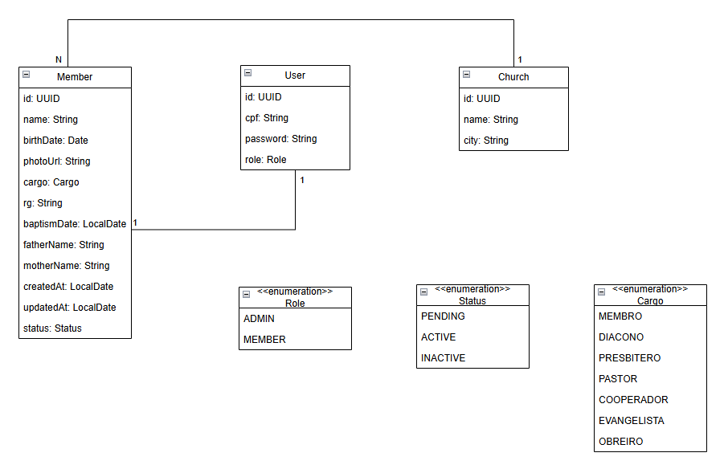

# Atue como um desenvolvedor backend experiente e escreva um código completo para um sistema de carteirinha de membros da igreja, seguindo as regras de negócio, modelagem, segurança, endpoints, estrutura de pacotes, requisitos técnicos, validações, fluxos e boas práticas descritas abaixo. O código deve ser pronto para produção, sem usar Lombok e com Java puro.

# 🚀 Projeto Backend - Sistema de Carteirinha de Membros da Igreja

## 🎯 Objetivo

Desenvolver um backend completo utilizando:

- Java 21
- Spring Boot
- Spring Data JPA
- Spring Security (JWT)
- H2 Database (em memória para desenvolvimento)
- PostgreSQL (para produção)
- Arquitetura REST

O sistema será responsável por gerenciar membros de uma igreja, autenticação de usuários e controle administrativo.
---

## 🧠 Regras de Negócio

### 👤 Usuário (User)
- Login será feito via **CPF + senha**
- CPF deve ser único
- Senha deve ser criptografada (BCrypt)
- Usuário pode ter papel:
    - ADMIN
    - MEMBER

---

### 🙋 Membro (Member)
- Todo Member está associado a um User (1:1)
- Um User pode existir sem ser Member
- Member possui status:
    - PENDING (aguardando aprovação)
    - ACTIVE (ativo)
    - INACTIVE (inativo)

---

### ⛪ Igreja (Church)
- Uma igreja possui vários membros (1:N)
- Cada membro pertence a apenas uma igreja

---

### 🎖️ Cargo (Cargo)
- Representa função do membro:
    - MEMBRO
    - DIACONO
    - PRESBITERO
    - PASTOR
    - COOPERADOR
    - EVANGELISTA
    - OBREIRO

---

## 🧱 Modelagem (Baseada no UML)

### User
- id: UUID
- cpf: String (unique)
- password: String
- role: Role
- relacionamento:
    - 1:1 com Member (opcional)

---

### Member
- id: UUID
- name: String
- birthDate: Date
- photoUrl: String
- cargo: Cargo (ENUM)
- rg: String
- baptismDate: LocalDate
- fatherName: String
- motherName: String
- createdAt: LocalDate
- updatedAt: LocalDate
- status: Status (ENUM)

Relacionamentos:
- ManyToOne com Church
- OneToOne com User (obrigatório)

---

### Church
- id: UUID
- name: String
- city: String

Relacionamento:
- OneToMany com Member

---

## 🔐 Segurança

- Implementar autenticação via JWT
- Login com CPF + senha
- Apenas usuários ACTIVE podem acessar
- Rotas ADMIN protegidas

---

## 📡 Endpoints obrigatórios

### Auth

- POST /auth/register
- POST /auth/login

---

### Member

- GET /members
- GET /members/{id}
- GET /members/pending
- PATCH /members/{id}/approve
- PATCH /members/{id}/inactive
- PATCH /members/{id}/cargo

---

### User

- GET /me

---

## 📦 Estrutura de pacotes

com.igreja.app
├── controller
├── service
├── repository
├── entity
├── dto
├── security
└── config

---

## ⚙️ Requisitos técnicos

- Usar JPA/Hibernate
- Usar UUID como ID
- Usar @Enumerated(EnumType.STRING)
- Seguir boas práticas REST
- Usar DTOs para entrada/saída
- Separar Controller, Service e Repository

---

## 🧪 Validações obrigatórias

- CPF único
- Senha criptografada
- Member inicia como:
    - status = PENDING
    - cargo = MEMBRO
- Não permitir login se status != ACTIVE

---

## 🔄 Fluxos

### Cadastro

1. Usuário envia dados
2. Criar User
3. Criar Member (PENDING)
4. Admin aprova

---

### Login

1. Validar CPF + senha
2. Verificar status
3. Gerar JWT

---

### Aprovação

1. Admin aprova Member
2. Status vira ACTIVE

---

## 🚀 Entregáveis esperados

Gerar código completo com:

- Entidades
- Repositories
- Services
- Controllers
- Configuração de segurança JWT
- DTOs
- Exceptions
- Configuração de banco

---

## 🧠 Boas práticas obrigatórias

- Código limpo (Clean Code)
- Separação de responsabilidades
- Tratamento de exceções
- Logs básicos
- Nomes claros

---

## ⚠️ Importante

- NÃO usar Lombok
- Usar Java puro com getters/setters
- Código deve ser pronto para produção

---

## 🎯 Resultado esperado

Um backend funcional que permita:

- Cadastro de membros
- Aprovação por admin
- Login seguro
- Consulta de dados
- Base para app mobile
